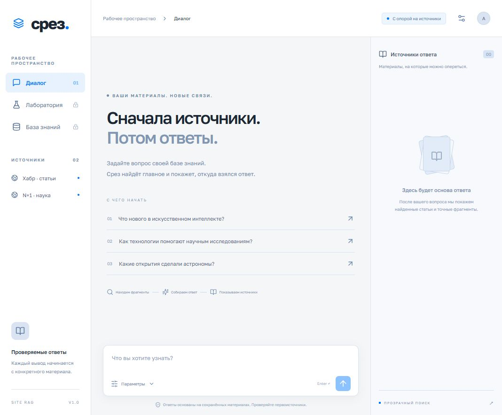

# Срез · RAG по сайтам и RSS

Загрузить материалы → найти фрагменты → решить, нужен ли rerank → получить ответ и источники.

Русскоязычный веб-интерфейс, публичный чат, защищённая админка, ручной сбор сайтов/RSS и файлов TXT/Markdown. Источники по умолчанию: Хабр и [«Элементы»](https://elementy.ru/novosti_nauki). VK API не используется.



## Быстрый запуск в Docker

Нужны Docker Engine с Compose и доступ к Hugging Face при первом использовании моделей. CPU, Python 3.12; рекомендованы 16 ГБ RAM и несколько гигабайт свободного места. Установка Python/Node на сервере не требуется.

1. Склонируйте репозиторий и скопируйте `.env.example` в `.env`.
2. Задайте `ADMIN_PASSWORD` (от 16 символов) и `SESSION_SECRET` (от 32). Подходящее случайное значение можно получить командой `python -c "import secrets; print(secrets.token_urlsafe(32))"` либо менеджером паролей.
3. Запустите:

```sh
docker compose up -d --build
```

Откройте [localhost:8090](http://localhost:8090). В «База знаний» войдите с `ADMIN_PASSWORD` и нажмите «Обновить все». Прогресс появится в списке задач. Перед первым ответом скачиваются и загружаются модели, поэтому первый запуск медленнее. Автоматического обновления по расписанию нет.

При обновлении прежний стандартный N+1 отключается однократно: из этой Docker-сети он не отвечал. Сохранённые документы не удаляются; отключённый источник исключается из поиска. Новый источник «Элементы» добавляется автоматически. Пользовательские источники и выбранное состояние «Элементов» сохраняются. Для загрузки нажмите обновление рядом с новым источником. Неполное обновление отмечается как «Частично», полный отказ сбора — как «Ошибка», с результатом по каждому источнику.

Один worker обрабатывает источники и страницы последовательно, с паузой между статьями. Для каждого источника используется одна HTTP-сессия с переиспользованием соединений. Сетевой таймаут, разрыв соединения и HTTP 408/429/500/502/503/504 допускают до трёх попыток: паузы 1 и 2 секунды либо больший `Retry-After` (до 30 секунд; более длительное ожидание сообщается как ошибка). HTTP 403 и ошибки TLS не обходятся. Админка показывает источник, повторы и этап; 644/644 фрагмента — размер индекса, а не число скачанных страниц. Если ревизия данных и настройки совпадают, готовый индекс проверяется и переиспользуется. Кнопка «Перестроить индекс» всегда запускает новое построение.

Без ключа LLM приложение работает: показывает выдержки и источники. `MODELS_ENABLED=0` отключает локальные ML-модели: сборщик создаёт BM25 с чанкингом по словам, а выдача явно сообщает о запасном режиме. Для обычного режима оставьте `MODELS_ENABLED=1`.

### sub2api

В `.env` задайте `SUB2API_API_KEY`, `SUB2API_BASE_URL` и `SUB2API_MODEL=gpt-5.6-luna`. Адрес должен быть доступен **из контейнера API**. `127.0.0.1` внутри контейнера обозначает сам контейнер.

Для уже работающего контейнера sub2api в сети `sub2api_sub2api-network`:

```sh
docker compose -f compose.yaml -f compose.sub2api.yaml up -d --build
```

Дополнительная конфигурация подключает только API к существующей сети и использует `http://sub2api:8080/v1`. Имя сети меняется через `SUB2API_NETWORK`. Сам sub2api эта команда не создаёт и не изменяет. Поиск и решение Laya выполняются локально; в LLM отправляются вопрос и пять найденных фрагментов.

### Публикация на сервере

По умолчанию порт привязан к `127.0.0.1`. Для внешнего доступа задайте `BIND_ADDRESS=0.0.0.0` и разместите HTTPS reverse proxy перед портом 8090. Для HTTPS включите `SECURE_COOKIE=1`. Админка не должна использоваться по открытому HTTP в интернете. При reverse proxy настройте реальный IP на Nginx доверенным способом: по умолчанию лимиты считают адрес непосредственного клиента Nginx; произвольный `X-Forwarded-For` не принимается.

Публичные запросы ограничены: 5 `/ask` и 30 `/search` в минуту на IP, один активный пайплайн и до четырёх ожидающих запросов. Превышение возвращает HTTP 429 с `Retry-After`. Один процесс API обязателен: ограничения и локальные модели находятся в нём. Масштабирование на несколько API-процессов требует внешнего лимитера и очереди.

## Как работает поиск

1. Worker скачивает RSS и полные статьи, HTML-страницы либо индексирует загруженные файлы. Сохраняет текст и метаданные в SQLite WAL. URL нормализуются; одинаковый текст хранится один раз, ссылки-алиасы сохраняются. Неизвестная дата публикации остаётся пустой; дата загрузки хранится отдельно.
2. E5 tokenizer разбивает текст на 384 токена с перекрытием 64. BM25 и FAISS строятся в новой директории; атомарно меняется только указатель готового индекса. Незавершённая сборка не затрагивает поисковую выдачу.
3. После фильтрации по источнику и дате BM25 и Dense отбирают по 30 кандидатов; RRF объединяет их в 20. Отбор и метрики работают на чанках, а метрики качества сворачивают повторы документов.
4. `auto`: `laya-multilingual` видит вопрос, позиции и оценки поиска, отрывки десяти кандидатов. Бюджет модели — 2048 токенов; состояние занимает до 1600, остальное оставлено типизированному вопросу. Ответ `keep` пропускает rerank при `answer_confidence ≥ 0.8`; остальные решения и ошибки запрашивают rerank. Для 0–1 кандидата rerank не запускается.
5. Отдельный multilingual cross-encoder `mmarco-mMiniLMv2-L12-H384-v1` переупорядочивает кандидатов. Его оценка является логитом, RRF — другой шкалой; API возвращает `score_type` и обе оценки. Равные значения сохраняют исходный порядок.
6. Запрос о новостях разбирается на тему и намерение узнать свежие материалы: «какие последние новости в ML» ищет «машинное обучение». Decision-модели нормализуются в «модели принятия решений»; это не diffusion. При ранжировании учитываются заголовки. Для широких новостных запросов в двадцати кандидатах допускается до трёх фрагментов документа, чтобы длинная статья не занимала всю выдачу. Точный исходный вопрос сохраняется для генерации.
7. Если подключена LLM, десять лучших кандидатов вместе с заголовками и датами передаются ей **без отсечения по абсолютному логиту reranker**. За один вызов она оценивает смысловую связь с вопросом, выбирает до пяти полезных фрагментов и возвращает типизированный JSON с ответом и ID источников либо отказ. Проверяются статус, ID и цитаты; возвращаются только процитированные фрагменты с перенумерованными ссылками. Даты относятся к загруженному корпусу, а не ко всем последним новостям интернета. Проверка структуры не доказывает фактическую правильность ответа или безошибочность смыслового отбора.
8. Без LLM, при ошибке API или некорректном JSON/цитатах используется локальный `context-v2` и экстрактивная выжимка. Положительный сигнал reranker дополняется явным подтверждением темы в тексте; отрицательный логит сам по себе не запрещает такой фрагмент. Поддерживаются ML/AI/LLM, модели принятия решений, русские/английские словоформы. Для частичного совпадения применяются `CONTEXT_MIN_TERM_COVERAGE=0.6` и, при наличии Dense, `CONTEXT_MIN_DENSE_SCORE=0.78`; `CONTEXT_MIN_RERANK_SCORE=0` — вспомогательный сигнал локального режима. Это эвристики с возможными ошибками, не калиброванные вероятности. В новостном локальном контексте учитываются даты и до двух фрагментов одной статьи. Если контекста нет, возвращается отказ с пустым списком источников. При полностью пустой выдаче LLM не вызывается. Автоматического платного повтора нет.

Режимы `never`, `always`, `auto` позволяют сравнить исходный поиск, обязательный rerank и решение Laya. Уверенность Laya не калибрована на нашем корпусе и не является доказанной вероятностью правильного решения. Реальная польза и задержка оцениваются отдельно.

Все три модели закреплены конкретными Hugging Face revision. Ошибка модели сохраняется до перезапуска процесса, чтобы не повторять загрузку на каждом публичном запросе. При недоступности Dense остаётся BM25; при отказе reranker сохраняется исходный порядок, предупреждение доступно в ответе.

## Интерфейс и API

Чат хранит историю только в `sessionStorage` текущего браузера. Каждый вопрос независим: предыдущие сообщения не отправляются в поиск/LLM. Источники справа показывают точные фрагменты и ссылки. На телефоне список расположен под ответом.

Админка: пароль, источники, включение/отключение, сбор, загрузка TXT/Markdown UTF-8 до 2 МБ, задачи и состояние индекса. Загруженные материалы становятся частью публичной базы. Сессия действует 12 часов: подписанная HttpOnly/SameSite cookie, CSRF-токен для изменений; смена пароля инвалидирует прежние сессии.

Через Nginx API имеет префикс `/api`; внутри контейнера — без него. Swagger: `/api/docs`.

| Метод и путь | Назначение |
|---|---|
| `GET /search?q=...` | Чанки, оценки, ссылки и диагностика |
| `GET /ask?q=...`, `POST /ask` | Ответ, режим `llm`/`extractive`, пять источников |
| `GET /sources`, `GET /health` | Публичные источники и проверка процесса |
| `POST /admin/login`, `GET /admin/session`, `POST /admin/logout` | Административная сессия |
| `GET/POST /admin/sources`, `PATCH /admin/sources/{id}` | Источники и включение |
| `GET/POST /admin/jobs` | Очередь ручных задач |
| `POST /admin/upload` | Загрузка TXT/Markdown |
| `GET /admin/status`, `POST /admin/compare` | Состояние и сравнение поиска |

Параметры: `q` (1–1000 символов), `limit` (1–20, по умолчанию 10), `rerank=auto|always|never`, `source_id`, `date_from`, `date_to` (YYYY-MM-DD). `/ask` также принимает `use_llm=false`; для ответа всегда выбирается до пяти фрагментов независимо от меньшего `limit`. Даты фильтруются в UTC, неизвестные даты не входят в ограниченный период.

```sh
curl 'http://localhost:8090/api/search?q=искусственный%20интеллект&rerank=auto'
curl -X POST http://localhost:8090/api/ask -H 'Content-Type: application/json' -d '{"q":"Какие открытия сделали астрономы?","use_llm":false}'
```

Ответ содержит `meta.gate`, `rerank_applied`, `timings_ms`, `warnings`, `index_version`, `corpus_hash`. `/search` возвращает ранжированных кандидатов и их `bm25_score`, `dense_score`, `rerank_score`; наличие в этой диагностической выдаче не означает допуск к ответу. `/ask` рассматривает двадцать кандидатов локально и до десяти в смысловом отборе LLM. `meta.context_filter` показывает способ отбора, число выбранных источников и локальную диагностику. Время смыслового отбора LLM включено в `generation`: это один совместный вызов для выбора и ответа. `effective_query`/`query_intent` показывают тему и намерение узнать свежие материалы. RRF, cosine и логиты имеют разные шкалы и напрямую не сравниваются. `/admin/compare` выполняет только поиск — генерация трёх LLM-ответов не запускается. Исходные секреты и тела ошибок upstream клиенту не возвращаются; журналы доступа API отключены.

## CLI, тесты и измерения

```sh
docker compose exec api site-rag collect --limit 20
docker compose exec api site-rag index
docker compose exec api site-rag search --q 'Как ИИ помогает искать работу?' --mode auto
docker compose exec api site-rag models
docker compose exec api site-rag evaluate
```

Для оценки через уже работающий API без второй копии моделей: `docker compose exec api site-rag evaluate --api-url http://127.0.0.1:8000`. JSON сохраняется в `/data/reports/results.json` на постоянном томе; `--output` позволяет выбрать другой доступный для записи путь. Оценка отклоняет корпус, хеш которого отличается от `benchmarks/corpus-manifest.json`.

CLI `collect` не перестраивает индекс автоматически; очередь в админке выполняет оба этапа. Для чистого измерения остановите публичные запросы и не запускайте одновременно несколько ML-процессов. [Методика и ограничения](benchmarks/README.md), [результаты](benchmarks/results.json), [отчёт о проверках](VALIDATION.md).

Для разработки: Python 3.12, CPU PyTorch, `pip install -r requirements.lock.txt`, `pip install -e '.[test]'`; затем `python -m pytest -q`. Frontend: `cd frontend`, `npm ci`, `npm run dev`. Backend: `uvicorn siterag.api:app --port 8091 --no-access-log --no-proxy-headers`. Переменные из `.env` надо передать в процесс; само приложение файл не читает.

CPU PyTorch устанавливайте перед остальными зависимостями: `pip install torch==2.15.0 --index-url https://download.pytorch.org/whl/cpu`.

Тома `rag-data` и `rag-models` сохраняют данные и модели. `docker compose down` сохраняет их; не используйте `down -v`, если нужно сохранить корпус. Для резервной копии SQLite используйте SQLite backup API либо копируйте том при остановленных API и worker. Точный повтор benchmark требует его снимка корпуса; свежая загрузка тех же URL может изменить тексты и хеши.
